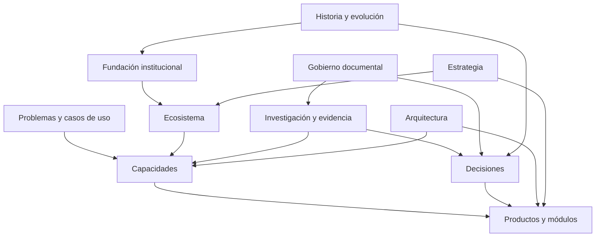

# Mapa de conocimiento de ZivaLatam

> **Estado:** APROBADO COMO MAPA CONCEPTUAL — versión 0.2 (APR-004)  
> **Propósito:** mostrar dónde encontrar información y cómo se conectan las áreas.

Este mapa aprobado describe dominios de conocimiento, no departamentos, sociedades, productos operativos ni sistemas implementados. Las áreas futuras se incorporarán al repositorio cuando tengan contenido real.

## Rutas de navegación

| Pregunta del lector | Dominio principal | Conexiones |
|---|---|---|
| ¿Qué es ZivaLatam y por qué existe? | Fundación | Historia, propósito, principios, estrategia |
| ¿Qué iniciativas forman parte de su visión? | Ecosistema | Portafolio, capacidades, productos |
| ¿Qué problema resuelve una iniciativa? | Casos de uso | Usuarios, mercado, investigación |
| ¿Qué capacidad común se necesita? | Capacidades | Productos, arquitectura, investigación |
| ¿Cómo se comporta un producto o módulo? | Productos | Casos de uso, capacidades, arquitectura |
| ¿Qué evidencia respalda una afirmación? | Investigación | Fuentes, normas, decisiones |
| ¿Por qué se tomó una decisión? | Gobierno / decisiones | Evidencia, alternativas, impactos |
| ¿Cómo se implementa una solución? | Arquitectura | Especificaciones, guías, referencia técnica |
| ¿Qué cambió con el tiempo? | Historia y evolución | Decisiones, versiones, archivo |

## Relaciones conceptuales actuales

El siguiente esquema es conceptual. No representa una arquitectura técnica implementada ni una secuencia de despliegue.

## Principio de ubicación principal

Cada expediente tiene una sola ubicación canónica. Otros dominios pueden enlazarlo y explicar su relevancia, pero no deben mantener copias completas que puedan divergir.

Ejemplo conceptual: una investigación sobre credenciales verificables se conserva en investigación/estándares y se enlaza desde identidad, productos y arquitectura cuando sea pertinente.

## Crecimiento controlado

- No crear una carpeta solo porque exista un nombre de producto en una lista.
- No presentar capacidades propuestas como servicios existentes.
- No inferir que una relación conceptual equivale a dependencia técnica.
- Mantener visibles los temas pendientes y las decisiones aún no tomadas.
- Cuando un dominio crezca, su README local será el índice de esa área.

## Documentos relacionados

- [Portal institucional](README.md)
- [Arquitectura del conocimiento](knowledge-architecture.md)
- [Índice maestro](master-index.md)
- [Glosario](glossary.md)
